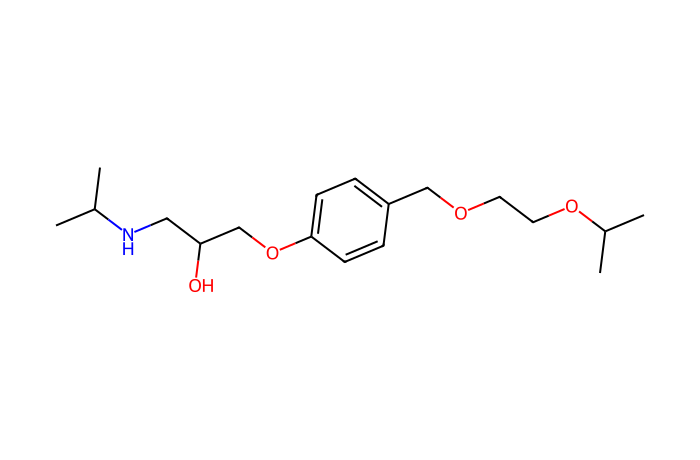

# MN Lab 1 · Spectral Similarity

[All labs](README.md) · [Lab 2 →](lab02-network-builder.md)

**About 45 min** · Building the network

How does a molecular network decide that two molecules are related? You will see, peak by peak, how two MS/MS spectra become one similarity score — the modified cosine — and how the settings change it.

**What you will learn**

- what an MS/MS spectrum shows and why related molecules give related spectra
- how the cosine and the modified cosine are calculated
- what fragment tolerance, intensity scaling and the edge rule do
- how to check a pair: mirror plot, LC peaks across samples, and the molecular family

## Downloads

- [FeatureFinder-local-v365-windows-x86_64-MN-labs.zip](https://github.com/YasinEl/temp_share/releases/download/mn-teaching-materials-2026-10-29/FeatureFinder-local-v365-windows-x86_64-MN-labs.zip) · Feature Finder v365 with the ten MN Labs, the GNPS libraries and all handouts (Windows, 87 MB)
- [urine_POS.zip](https://github.com/YasinEl/temp_share/releases/download/urine-pos-test-data-2026-10-28/urine_POS.zip) · urine, positive mode: 11 mzML files + metadata.tsv (135 MB)
- Worksheet to write your answers in: [MN_Lab_1_Spectral_Similarity_questions.docx](https://github.com/YasinEl/temp_share/releases/download/mn-teaching-materials-2026-10-29/MN_Lab_1_Spectral_Similarity_questions.docx)
- Printable handout (same content as this page): [MN_Lab_1_Spectral_Similarity_handout.docx](https://github.com/YasinEl/temp_share/releases/download/mn-teaching-materials-2026-10-29/MN_Lab_1_Spectral_Similarity_handout.docx)

## Step by step

**Before you start:** do [Getting started](getting-started.md) with the 11 files of urine_POS (Engine **v1 (classic)**), then open **MN Lab 1 · Spectral Similarity** from the **All plugins** tab.

1. Panel 1 shows two slots, **A** and **B**. Click the guided example **Prodrug → active drug**: A is perindopril, B perindoprilat. Both are pinned to the top of the feature table.
2. Panel 2 gives the score, the number of matched peaks and the precursor Δ, and says whether the pair passes the edge rule. Read Δ and the matched peaks. → **Worksheet [Q1](#q1)**
3. Panel 3, the **mirror plot**: A on top, B below. Blue lines = same-m/z matches, orange = shifted matches, grey = unmatched. Hover over peaks to read their m/z.
4. Untick **allow shifted matches** in the settings and watch the score. → **[Q2](#q2)**
5. Move the **fragment tolerance** slider to 0.001 Da and to 0.05 Da, then back to 0.010. → **[Q3](#q3)**
6. Untick **square-root intensities** and read the line “the 3 best peak pairs give …% of the score”. Tick it again. → **[Q4](#q4)**
7. Panel 6 compares A with every other spectrum of the run. The histogram shows how rare high scores are; the table lists A's best neighbours and whether they are connected in the app's network. Also open the example **Two drugs, same class** (atenolol vs bisoprolol). → **[Q5](#q5)**
8. Back to **Prodrug → active drug**. Panel 4 shows the LC peak of A and of B in every sample (same colour = same sample; pool dashed, blanks dotted). Which samples have which molecule? Look the patients up in the metadata. → **[Q6](#q6)**
9. Panel 5 draws the whole molecular family of A and B with library names (green) and Δ on every edge. Click a node to put it into slot A or B. → **[Q7](#q7)**

> **Watch out**
>
> - A high score with fewer than 6 matched peaks is not enough for an edge: small spectra match by chance.
> - “Same m/z” edges usually connect isomers or one compound split into two features.
> - The same Δ appears for many molecule pairs: once you know what −28.031 means for ramipril, you can apply it to an unknown family.

## Questions

Write your answers in the worksheet [MN_Lab_1_Spectral_Similarity_questions.docx](https://github.com/YasinEl/temp_share/releases/download/mn-teaching-materials-2026-10-29/MN_Lab_1_Spectral_Similarity_questions.docx).

> **The big question for this dataset.** Which drugs did these patients take, and which drug analogues (metabolites, related compounds) can you find next to them in the network? Do the drugs and analogues you find fit what the metadata says about each person (number of blood-pressure drug classes, diabetes, smoking, kidney function)? Use this lab to check that two spectra really are related, and the other MN Labs to find the families and the samples they occur in.

#### Q1

Open the example *Prodrug → active drug*. What is Δ between the two precursors, and which atoms does it correspond to? Are most matched peaks blue or orange? What does that tell you about *where* in the molecule the change happened?

#### Q2

Untick “allow shifted matches”. How much does the score drop? Would the two still be connected in the network?

#### Q3

Move the tolerance to 0.001 Da and then to 0.05 Da. Why does a very small tolerance lose matches, and what is the risk of a very large one?

#### Q4

Untick “square-root intensities”. How much of the score do the 3 best peak pairs now give (panel 2)? Why do networking tools damp the biggest peaks?

#### Q5

In panel 6, how many of the ~4,600 spectra pass the edge rule? Pick A's best neighbour that is *not* connected in the network.tsv and explain why (hint: top-K and family size limits, MN Lab 2).

#### Q6

Panel 4: in which samples are the prodrug and the active drug found? Do the two always occur together? Look the patients up in the metadata — what could explain it when only one of them is there?

#### Q7

Panel 5: which members of A's family have a library name, and which do not? For two unnamed members, use the Δ on the edge to propose what they are (e.g. +176.032 = glucuronide, −28.031 = ethyl ester hydrolysis, +15.995 = hydroxylation).

## Background

### MS/MS spectra

In MS/MS the instrument isolates one ion (the **precursor**), breaks it in a collision cell and records the **fragments**. A molecule always breaks at its weakest bonds, so its fragment pattern is like a fingerprint. Two molecules that differ only by a small group (a methyl, a hydroxyl, an ethyl ester) usually share most fragments.

### Cosine similarity

Both spectra are turned into vectors: every fragment m/z is a position, its intensity the value. Peaks of A and B **match** when their m/z differ by less than the **fragment tolerance** (0.01 Da here). The score is the sum over matched pairs of intensity(A) × intensity(B) after each spectrum is scaled to length 1: 1 = identical, 0 = nothing in common. Intensities are first **square-rooted** so that one huge peak cannot decide the score alone.

### The modified cosine

If B carries a modification, every fragment of B that still contains it is heavier by exactly the precursor difference **Δ**. The modified cosine therefore also allows **shifted matches**: a peak of A matches a peak of B at m/z + Δ. Fragments that match directly (blue) do not contain the modification; shifted fragments (orange) do. This is why the network can connect a drug with its metabolites.

### The edge rule

The app draws an edge when the modified cosine is **≥ 0.70 with ≥ 6 matched peaks**. Each node then keeps only its **10 best edges (top-K)**, and families larger than 100 are cut (MN Lab 2).

| Δ m/z | change | typical example |
|---|---|---|
| −28.031 | C₂H₄ (ethyl ester → acid) | prodrug → active drug |
| +14.016 | CH₂ | homologues, methylation |
| +15.995 | O | hydroxylation (oxidation) |
| +176.032 | C₆H₈O₆ | glucuronidation (phase II) |
| +79.957 | SO₃ | sulfation (phase II) |
| +1.003 | ¹³C | an isotope peak, not chemistry |

## Molecules in this lab

Red: the part that differs from the partner molecule. m/z values are the ions seen in positive mode.

| Structure | Molecule |
|---|---|
|  | **Perindopril** C19H32N2O5 · [M+H]⁺ 369.2384 ACE inhibitor (blood pressure); prodrug, ethyl ester *in this run: 369.238 @ 3.93 min (pool)* |
|  | **Perindoprilat** C17H28N2O5 · [M+H]⁺ 341.2071 active drug: the ethyl ester is hydrolysed (−C₂H₄) *in this run: 341.207 @ 4.43 and 7.05 min* |
|  | **Ramipril** C23H32N2O5 · [M+H]⁺ 417.2384 ACE inhibitor; prodrug, ethyl ester *in this run: 417.238 @ 3.77 min (patient 08)* |
|  | **Ramiprilat** C21H28N2O5 · [M+H]⁺ 389.2071 active drug (−C₂H₄) *in this run: 389.207 @ 4.41 and 7.06 min* |
|  | **Atenolol** C14H22N2O3 · [M+H]⁺ 267.1703 beta-blocker (blood pressure) *in this run: 267.170 @ 13.34 min (patients 03, 57)* |
|  | **Bisoprolol** C18H31NO4 · [M+H]⁺ 326.2326 beta-blocker (blood pressure) *in this run: 326.232 @ 7.82 min (patients 54, 18)* |
|  | **Acetylcarnitine (C2)** C9H17NO4 · [M+H]⁺ 204.1230 acylcarnitine, body-made *in this run: 204.123 @ 10.69 min* |
|  | **Propionylcarnitine (C3)** C10H19NO4 · [M+H]⁺ 218.1387 +CH₂ (14.016) *in this run: 218.139 @ 9.13 min* |

---

[All labs](README.md) · [Lab 2 →](lab02-network-builder.md)
