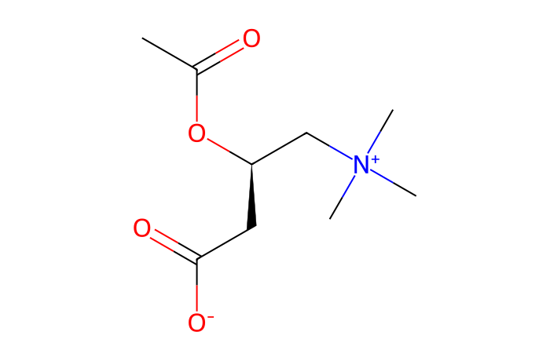
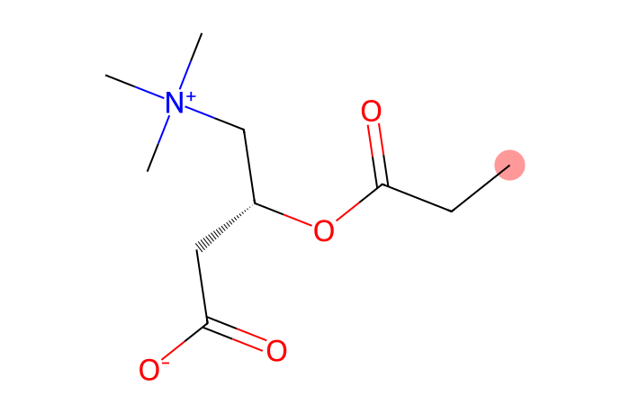
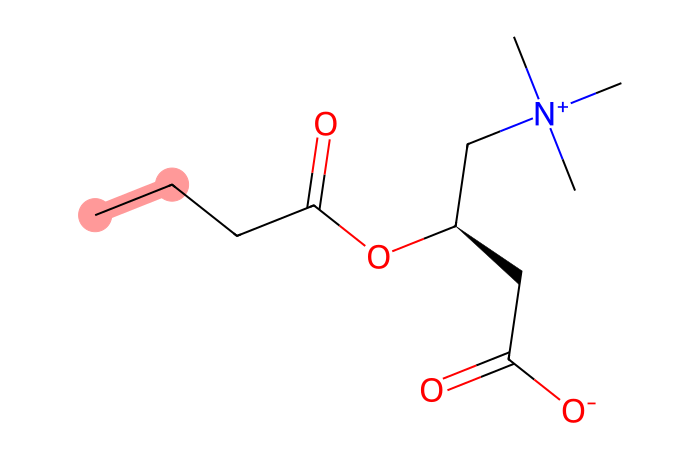

# MN Lab 2 · Network Builder

[← Lab 1](lab01-spectral-similarity.md) · [All labs](README.md) · [Lab 3 →](lab03-families-patients.md)

**About 40 min** · Building the network

A molecular network is built from thousands of pairwise similarity scores by a few simple rules. You will change those rules and see how the families form, merge and fall apart.

**What you will learn**

- the steps from MS/MS spectra to molecular families
- what the similarity threshold, minimum matched peaks, top-K and the family-size cap do
- why some real metabolites remain singletons
- how to read a family: edge labels, colours by sample type

## Downloads

- [FeatureFinder-local-v365-windows-x86_64-MN-labs.zip](https://github.com/YasinEl/temp_share/releases/download/mn-teaching-materials-2026-10-29/FeatureFinder-local-v365-windows-x86_64-MN-labs.zip) · Feature Finder v365 with the ten MN Lab dashboards and the spectral library (Windows, 25 MB)
- [urine_POS.zip](https://github.com/YasinEl/temp_share/releases/download/urine-pos-test-data-2026-10-28/urine_POS.zip) · urine, positive mode: 11 mzML files + metadata.tsv (135 MB)
- Worksheet to write your answers in: [MN_Lab_2_Network_Builder_questions.docx](https://github.com/YasinEl/temp_share/releases/download/mn-teaching-materials-2026-10-29/MN_Lab_2_Network_Builder_questions.docx)
- Printable handout (same content as this page): [MN_Lab_2_Network_Builder_handout.docx](https://github.com/YasinEl/temp_share/releases/download/mn-teaching-materials-2026-10-29/MN_Lab_2_Network_Builder_handout.docx)

## Step by step

**Before you start:** do [Getting started](getting-started.md) with the 11 files of urine_POS (Engine **v1 (classic)**, Quantification **Peak area**), then open **MN Lab 2 · Network Builder** from the **All plugins** tab.

1. Panel 1, **the recipe**, counts what is left after each step: MS/MS spectra → pairs → similar enough → after top-K → after the size cap. Read the number of families and singletons for the app defaults. → **Worksheet [Q1](#q1)**
2. Click **recompute every pair here**: the browser scores all pairs itself (about 15 s). The agreement line tells you how many of the app's edges it reproduces.
3. Panel 2, **the rules**: drag the minimum similarity down to 0.50 and watch the recipe and the family-size plot. Then set top-K to 3. Finally switch top-K off. → **[Q2](#q2)**
4. Reset the rules. Set the **maximum family size** to 20 and look at the largest family. → **[Q3](#q3)**
5. Panel 3 lists the families; panel 4 draws one. Find the family that contains m/z 341.207 (type it into **Find a family by m/z**). Read the edge labels and colour the nodes by **where it was detected**. → **[Q4](#q4)**
6. Find the family of m/z 204.123 and read its edge labels. → **[Q5](#q5)**

> **Watch out**
>
> - There is no single correct setting: stricter rules give cleaner but smaller families; looser rules connect more but also connect nonsense.
> - Top-K and the size cap remove edges that passed the similarity test — a missing edge does not prove two spectra are dissimilar.

## Questions

Write your answers in the worksheet [MN_Lab_2_Network_Builder_questions.docx](https://github.com/YasinEl/temp_share/releases/download/mn-teaching-materials-2026-10-29/MN_Lab_2_Network_Builder_questions.docx).

#### Q1

With the app defaults, how many MS/MS spectra end up in a family and how many stay *singletons*? Why might a real metabolite stay a singleton?

#### Q2

Click “recompute every pair here” and drag the similarity down to 0.50. What happens to the largest family? Now set top-K to 3. Explain what top-K protects against.

#### Q3

Set the maximum family size to 20. Which edges are removed first when a family is too large?

#### Q4

Find the family that contains m/z 341.207. Read the edge labels: what chemical changes connect its members? Colour by “where it was detected”: is this family made by the body or taken in?

#### Q5

Find a family with many *CH₂* edges. What kind of compounds form such ladders? (Hint: try m/z 204.123.)

## Background

### From pairs to families

Every MS/MS spectrum (one consensus spectrum per feature) is compared with every other one: about 10 million pairs for 4,600 spectra. Pairs that pass the **similarity threshold** (≥ 0.70) with **≥ 6 matched peaks** become candidate edges. Connected groups of nodes are the **molecular families**; nodes without any edge are **singletons**.

### Why extra filters are needed

Some spectra are similar to almost everything (few, very common fragments). Without limits they act as **hubs** and pull unrelated molecules into one giant family. **Top-K** keeps an edge only if it is among the K best edges of **both** its nodes (K = 10). The **family-size cap** (100) cuts the weakest edges of an oversized family until it falls apart into smaller ones.

### Reading a family

Edge labels give the mass difference and what it may mean. Colouring nodes by **where they were detected** separates body-made molecules (in every sample) from things taken in (drugs, diet: in only some patients, often also in the pool).

## Molecules in this lab

The acylcarnitines form a CH₂ ladder: each member has one more CH₂ in its fatty-acid chain (red).

| Structure | Molecule |
|---|---|
|  | **Perindopril** C19H32N2O5 · [M+H]⁺ 369.2384 ACE inhibitor (blood pressure); prodrug, ethyl ester *in this run: 369.238 @ 3.93 min (pool)* |
|  | **Perindoprilat** C17H28N2O5 · [M+H]⁺ 341.2071 active drug: the ethyl ester is hydrolysed (−C₂H₄) *in this run: 341.207 @ 4.43 and 7.05 min* |
|  | **Acetylcarnitine (C2)** C9H17NO4 · [M+H]⁺ 204.1230 acylcarnitine, body-made *in this run: 204.123 @ 10.69 min* |
|  | **Propionylcarnitine (C3)** C10H19NO4 · [M+H]⁺ 218.1387 +CH₂ (14.016) *in this run: 218.139 @ 9.13 min* |
|  | **Butyrylcarnitine (C4)** C11H21NO4 · [M+H]⁺ 232.1543 +CH₂ again *in this run: 232.154* |
|  | **L-Carnitine** C7H15NO3 · [M+H]⁺ 162.1125 body-made: carries fatty acids into mitochondria *in this run: 162.113 @ 12.16 min (everyone)* |

---

[← Lab 1](lab01-spectral-similarity.md) · [All labs](README.md) · [Lab 3 →](lab03-families-patients.md)
