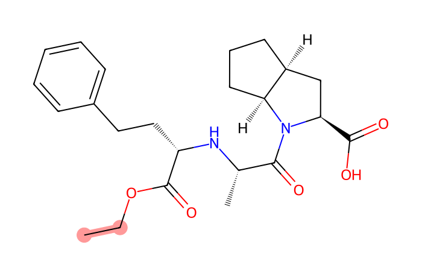
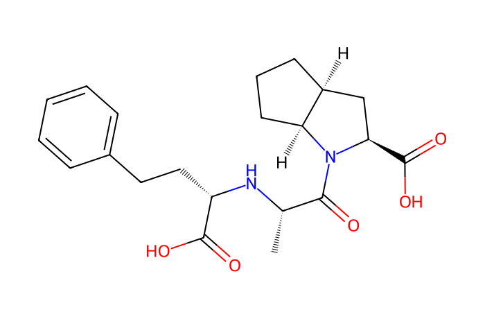
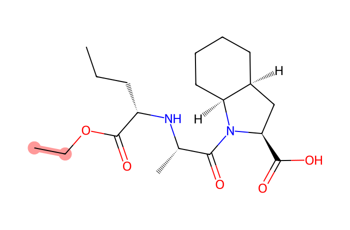
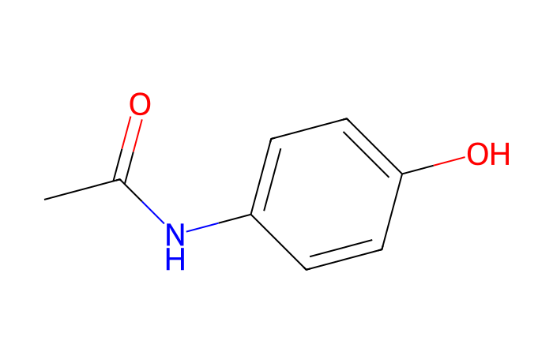
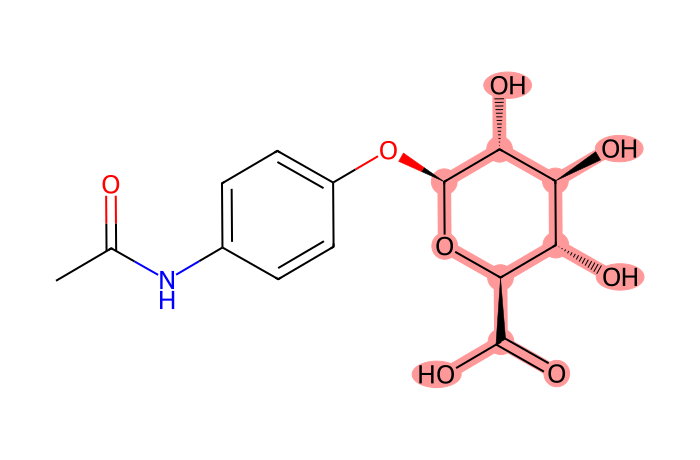

# MN Lab 3 · Families × Patients

[← Lab 2](lab02-network-builder.md) · [All labs](README.md) · [Lab 4 →](lab04-from-scans-to-features.md)

**About 50 min** · Interpreting it

What do the molecular families mean? You will put every family next to the patients and their metadata, and use the mass differences on the edges to understand the chemistry inside a family.

**What you will learn**

- how to tell body-made families from drug-derived ones
- how to use patient metadata (drug classes, diabetes, kidney function) to interpret families
- the most common mass differences and which of them are chemistry and which are measurement artefacts

## Downloads

- [FeatureFinder-local-v365-windows-x86_64-MN-labs.zip](https://github.com/YasinEl/temp_share/releases/download/mn-teaching-materials-2026-10-29/FeatureFinder-local-v365-windows-x86_64-MN-labs.zip) · Feature Finder v365 with the ten MN Labs, the GNPS libraries and all handouts (Windows, 87 MB)
- [urine_POS.zip](https://github.com/YasinEl/temp_share/releases/download/urine-pos-test-data-2026-10-28/urine_POS.zip) · urine, positive mode: 11 mzML files + metadata.tsv (135 MB)
- Worksheet to write your answers in: [MN_Lab_3_Families_Patients_questions.docx](https://github.com/YasinEl/temp_share/releases/download/mn-teaching-materials-2026-10-29/MN_Lab_3_Families_Patients_questions.docx)
- Printable handout (same content as this page): [MN_Lab_3_Families_Patients_handout.docx](https://github.com/YasinEl/temp_share/releases/download/mn-teaching-materials-2026-10-29/MN_Lab_3_Families_Patients_handout.docx)

## Step by step

**Before you start:** do [Getting started](getting-started.md) with the 11 files of urine_POS (Engine **v1 (classic)**), then open **MN Lab 3 · Families × Patients** from the **All plugins** tab.

1. Panel 1 is a heatmap: one row per family, one column per sample. Use the row filter **found in every patient** and look at the largest families and their library names. → **Worksheet [Q1](#q1)**
2. Switch the filter to **found in only 1–3 patients** and order the columns by **number of blood-pressure drug classes**. → **[Q2](#q2)**
3. Click a row to open the family in panel 2 (graph, members and edge labels). Find the family with the library match **ramipril**; note the samples and the Δ between ramipril and its neighbour. Then find the family with m/z 341.207 / 369.238. → **[Q3](#q3)**
4. Order the columns by **kidney function (GFR)**. Look at patient 54. → **[Q4](#q4)**
5. Panel 3, the **mass-difference detective**, counts all edge Δ values in the network. → **[Q5](#q5)**
6. Click a Δ = 176.032 edge in the detective's list to open its mirror plot. → **[Q6](#q6)**

> **Watch out**
>
> - A family can contain both body-made and drug-derived members: always look at the members, not only the family.
> - Absent in a patient does not mean the patient does not take the drug: it may be below the detection limit, in the wrong polarity, or excreted later.

## Questions

Write your answers in the worksheet [MN_Lab_3_Families_Patients_questions.docx](https://github.com/YasinEl/temp_share/releases/download/mn-teaching-materials-2026-10-29/MN_Lab_3_Families_Patients_questions.docx).

#### Q1

Show families “found in every patient”. What could these be? Pick one with a library match and check.

#### Q2

Show families “found in only 1–3 patients” and order patients by the number of blood-pressure drug classes. Do drug-like families appear in the patients who take more drugs?

#### Q3

Find the family with ramipril (library match). Which patients have it? What connects ramipril (417.238) and ramiprilat (389.207)? Now find the family at m/z 341.207 / 369.238: the same Δ again — what does that tell you about this unannotated family?

#### Q4

Patient 54 has very low kidney function (GFR ≈ 11). Order by GFR: does this patient stand out?

#### Q5

In the detective, what are the three most common named mass differences? Which of them are chemistry, and which are artefacts of how the instrument measures (isotopes, adducts)?

#### Q6

Pick a Δ = 176.032 edge. Look at the mirror plot: which fragments are shared directly, and why is the glucuronide's own fragment not shifted?

## Background

### The samples

Morning urine of 8 stroke patients, measured with HILIC chromatography and positive electrospray on an Orbitrap. The metadata gives sex, age, smoking, diabetes, the **number of blood-pressure drug classes** each patient takes (2–8), urine creatinine and kidney function (**GFR**; patient 54 has kidney failure, GFR ≈ 11). The **pooled urine** contains a little of every patient of the full study (22 patients), so it can contain molecules from people not in this subset.

### Body-made or taken in?

Metabolites the body makes (amino acids, acylcarnitines, nucleosides) are found in **every** patient. Drugs and their metabolites are found only in the patients who take them. Diet, smoking and the environment add further patient-specific molecules.

### Drug metabolism in brief

**Phase I** changes the drug itself: hydrolysis (e.g. an ethyl ester → acid, −C₂H₄), oxidation (+O), demethylation (−CH₂). **Phase II** attaches a polar group so the kidney can excrete it: glucuronic acid (+176.032) or sulfate (+79.957). Many blood-pressure drugs are **prodrugs** (inactive esters) that the liver turns into the active acid.

| Δ m/z | meaning | chemistry or artefact? |
|---|---|---|
| 0 (same m/z) | isomer, or one compound split in two features | either |
| 14.016 | CH₂ | chemistry |
| 15.995 | O | chemistry |
| 2.016 | H₂ | chemistry |
| 28.031 | C₂H₄ | chemistry (ester) |
| 176.032 | glucuronic acid | chemistry |
| 1.003 | ¹³C isotope | artefact |
| 21.982 | Na instead of H | artefact (adduct) |
| 17.027 | NH₃ / NH₄⁺ adduct | often artefact |

## Molecules in this lab

Ramipril and perindopril are both ACE-inhibitor prodrugs: the same ethyl ester (red) is removed in the body.

| Structure | Molecule |
|---|---|
|  | **Ramipril** C23H32N2O5 · [M+H]⁺ 417.2384 ACE inhibitor; prodrug, ethyl ester *in this run: 417.238 @ 3.77 min (patient 08)* |
|  | **Ramiprilat** C21H28N2O5 · [M+H]⁺ 389.2071 active drug (−C₂H₄) *in this run: 389.207 @ 4.41 and 7.06 min* |
|  | **Perindopril** C19H32N2O5 · [M+H]⁺ 369.2384 ACE inhibitor (blood pressure); prodrug, ethyl ester *in this run: 369.238 @ 3.93 min (pool)* |
|  | **Perindoprilat** C17H28N2O5 · [M+H]⁺ 341.2071 active drug: the ethyl ester is hydrolysed (−C₂H₄) *in this run: 341.207 @ 4.43 and 7.05 min* |
|  | **Paracetamol (acetaminophen)** C8H9NO2 · [M+H]⁺ 152.0706 painkiller; also carry-over into the blanks *in this run: 152.071 @ 7.15 min* |
|  | **Paracetamol glucuronide** C14H17NO8 · [M+H]⁺ 328.1027 phase II metabolite (+176.032) *in this run: 328.102 @ 8.62 min* |

---

[← Lab 2](lab02-network-builder.md) · [All labs](README.md) · [Lab 4 →](lab04-from-scans-to-features.md)
