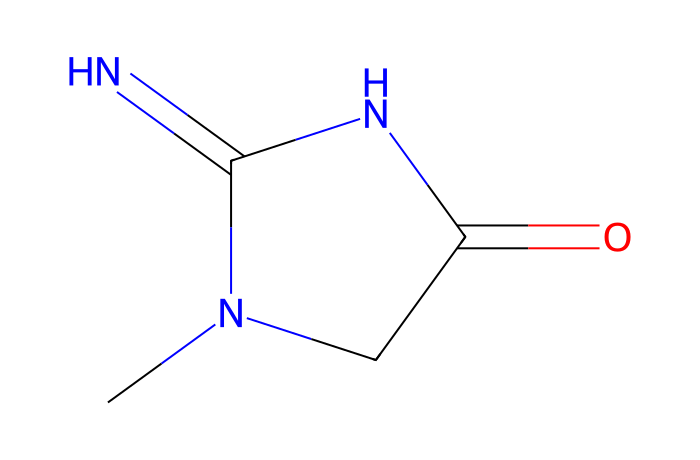
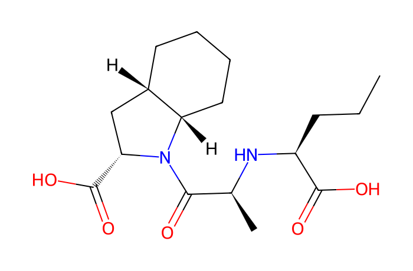

# MN Lab 4 · From Scans to Features

[← Lab 3](lab03-families-patients.md) · [All labs](README.md) · [Lab 5 →](lab05-one-compound-many-features.md)

**About 45 min** · Data → features

Before there is a network there is a feature table. You will follow one ion from the raw MS1 scans to its chromatogram, its peak area and one row of the table — and see which ions the instrument chose to fragment.

**What you will learn**

- what an extracted-ion chromatogram (XIC) is and why its m/z window matters
- how peak areas are integrated
- how isotope patterns reveal the number of carbon atoms
- why retention times must be aligned and what gap-filling does
- data-dependent acquisition (DDA): why not every feature has an MS/MS

## Downloads

- [FeatureFinder-local-v365-windows-x86_64-MN-labs.zip](https://github.com/YasinEl/temp_share/releases/download/mn-teaching-materials-2026-10-29/FeatureFinder-local-v365-windows-x86_64-MN-labs.zip) · Feature Finder v365 with the ten MN Labs, the GNPS libraries and all handouts (Windows, 27 MB)
- [urine_POS.zip](https://github.com/YasinEl/temp_share/releases/download/urine-pos-test-data-2026-10-28/urine_POS.zip) · urine, positive mode: 11 mzML files + metadata.tsv (135 MB)
- Worksheet to write your answers in: [MN_Lab_4_From_Scans_to_Features_questions.docx](https://github.com/YasinEl/temp_share/releases/download/mn-teaching-materials-2026-10-29/MN_Lab_4_From_Scans_to_Features_questions.docx)
- Printable handout (same content as this page): [MN_Lab_4_From_Scans_to_Features_handout.docx](https://github.com/YasinEl/temp_share/releases/download/mn-teaching-materials-2026-10-29/MN_Lab_4_From_Scans_to_Features_handout.docx)

## Step by step

**Before you start:** do [Getting started](getting-started.md) with the 11 files of urine_POS (Engine **v1 (classic)**, Quantification **Peak area**), then open **MN Lab 4 · From Scans to Features** from the **All plugins** tab.

1. Panel 1: pick **creatinine** (type 114.066 or use the example button) and choose the file of patient 57.
2. Panel 2 shows the XIC in that file with the integration window (dashed lines). Change the m/z window to 1 ppm and to 100 ppm, then back to 10. → **Worksheet [Q1](#q1)**
3. Look at the scan dots on the XIC and the integration window. → **[Q2](#q2)**
4. Panel 3 shows the MS1 scan at the top of the peak, zoomed to the ion and its isotopes; the text gives M+1 as % of M. → **[Q3](#q3)**
5. Panel 4 overlays the same ion in every file; tick and untick **RT correction**. Try perindoprilat (341.207) too. → **[Q4](#q4)**
6. Panel 5 shows the peak area per sample; hatched bars are gap-filled values. Find a feature with hatched bars (creatinine has them in the blanks). → **[Q5](#q5)**
7. Panel 6, the **DDA map**: every MS1 feature of the chosen file, coloured by whether it received an MS/MS. → **[Q6](#q6)**

> **Watch out**
>
> - A peak area is only comparable between samples for the same feature, not between different molecules (ionisation efficiency differs).
> - A zero in the feature table means “not found”, not “present at zero”.

## Questions

Write your answers in the worksheet [MN_Lab_4_From_Scans_to_Features_questions.docx](https://github.com/YasinEl/temp_share/releases/download/mn-teaching-materials-2026-10-29/MN_Lab_4_From_Scans_to_Features_questions.docx).

#### Q1

Pick creatinine (m/z 114.066). Narrow the m/z window to 1 ppm, then widen it to 100 ppm. What goes wrong at each extreme? Why do instruments with higher resolution allow narrower windows?

#### Q2

The peak area in the table is the area under the curve between the two dashed lines. Does it depend on the m/z window? On how many scans cover the peak?

#### Q3

In panel 3, read the intensity of the M+1 peak relative to M. Each carbon adds ~1.1 %. Roughly how many carbons does creatinine (C₄H₇N₃O) have — does it fit?

#### Q4

In panel 4, tick and untick the retention-time correction. Why do the files not elute at exactly the same time, and why does the feature finder need to correct for it before it can say “this is the same ion”?

#### Q5

Find a feature with hatched (gap-filled) bars. What did the software do for those samples, and why can that create a false “present in the blank”?

#### Q6

In panel 6, how many features in this file have no MS/MS? Where are they — low or high intensity, crowded RT regions? What does that mean for the molecular network?

## Background

### LC-MS data

Every ~0.1–0.3 s the mass spectrometer records a full **MS1 scan** (all ions and their intensities). Plotting the intensity of one m/z (± a ppm window) against time gives the **XIC**; the area under its peak is the **peak area** in the feature table. ppm = parts per million: 10 ppm at m/z 114 is ±0.0011 Da.

### Isotopes

About 1.1% of all carbon is ¹³C. A molecule with n carbons therefore has an M+1 peak of about **n × 1.1%** of the main (M) peak, at +1.003 Da. This lets you estimate the carbon count from one MS1 scan.

### Alignment and gap-filling

The same compound elutes a few seconds earlier or later in each run. The software models this drift and corrects the retention times before it matches features across files. Where a feature was not detected in a sample, **gap-filling** integrates the expected m/z/RT window anyway — useful for low signals, dangerous when the window contains background.

### DDA

In **data-dependent acquisition** the instrument picks the most intense ions of each MS1 scan (top-N) for MS/MS. Weak ions and ions in crowded regions are often skipped, so they get **no MS/MS** and cannot appear in the molecular network.

## Molecules in this lab

Creatinine: 4 carbons → M+1 ≈ 4.4%. Perindoprilat: 17 carbons → M+1 ≈ 19%.

| Structure | Molecule |
|---|---|
|  | **Creatinine** C4H7N3O · [M+H]⁺ 114.0662 body-made, from muscle creatine; cleared by the kidney *in this run: 114.066 @ ~9.5 min (everyone)* |
|  | **Perindoprilat** C17H28N2O5 · [M+H]⁺ 341.2071 active drug: the ethyl ester is hydrolysed (−C₂H₄) *in this run: 341.207 @ 4.43 and 7.05 min* |

---

[← Lab 3](lab03-families-patients.md) · [All labs](README.md) · [Lab 5 →](lab05-one-compound-many-features.md)
