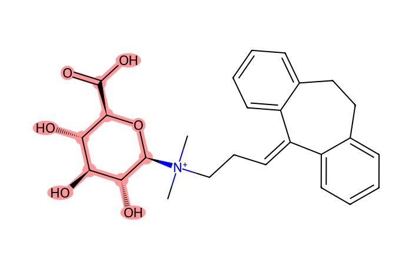

# MN Lab 6 · Annotation Propagation

[← Lab 5](lab05-one-compound-many-features.md) · [All labs](README.md) · [Lab 7 →](lab07-can-i-trust-this-feature.md)

**About 45 min** · Interpreting it

Only a few percent of the spectra match a library. The network can carry these names further: an unknown connected to a known compound by a recognisable Δ is probably a close analogue. You will judge such proposals.

**What you will learn**

- how much a library annotates and how much the network could add
- how to build a candidate name from anchor + Δ
- how to check a proposal: mirror plot, retention time, co-occurrence
- why a weak anchor must not be propagated

## Downloads

- [FeatureFinder-local-v365-windows-x86_64-MN-labs.zip](https://github.com/YasinEl/temp_share/releases/download/mn-teaching-materials-2026-10-29/FeatureFinder-local-v365-windows-x86_64-MN-labs.zip) · Feature Finder v365 with the ten MN Labs, the GNPS libraries and all handouts (Windows, 27 MB)
- [urine_POS.zip](https://github.com/YasinEl/temp_share/releases/download/urine-pos-test-data-2026-10-28/urine_POS.zip) · urine, positive mode: 11 mzML files + metadata.tsv (135 MB)
- Worksheet to write your answers in: [MN_Lab_6_Annotation_Propagation_questions.docx](https://github.com/YasinEl/temp_share/releases/download/mn-teaching-materials-2026-10-29/MN_Lab_6_Annotation_Propagation_questions.docx)
- Printable handout (same content as this page): [MN_Lab_6_Annotation_Propagation_handout.docx](https://github.com/YasinEl/temp_share/releases/download/mn-teaching-materials-2026-10-29/MN_Lab_6_Annotation_Propagation_handout.docx)

## Step by step

**Before you start:** do [Getting started](getting-started.md) with the 11 files of urine_POS (Engine **v1 (classic)**), then open **MN Lab 6 · Annotation Propagation** from the **All plugins** tab.

1. Panel 1 shows how many features with MS/MS have a library match, and how many sit in a family that has one. → **Worksheet [Q1](#q1)**
2. Panel 2 lists the candidates: an unknown feature next to a library match, with Δ and the proposed change. Find the ramipril candidates (filter or sort). → **[Q2](#q2)**
3. Click a candidate: panel 3 draws its family, panel 4 shows the evidence — mirror plot (anchor vs candidate) and the areas in each sample. → **[Q2](#q2)**
4. Find a candidate with Δ = 176.032 and compare the retention times of anchor and candidate. → **[Q3](#q3)**
5. Untick **only Δ that match a known change** and pick a candidate with an unexplained Δ. → **[Q4](#q4)**
6. In the evidence text of each candidate, read the anchor's library cosine and matched peaks. Filter for weak anchors such as “Ciprofloxacin” or “Carbidopa” and compare the anchor's m/z with the true m/z of that compound. → **[Q5](#q5)**

> **Watch out**
>
> - Write proposals as “anchor − C₂H₄”, not as a name you have not confirmed.
> - Δ values can be combinations: 204.064 = −C₂H₄ + glucuronic acid.

## Questions

Write your answers in the worksheet [MN_Lab_6_Annotation_Propagation_questions.docx](https://github.com/YasinEl/temp_share/releases/download/mn-teaching-materials-2026-10-29/MN_Lab_6_Annotation_Propagation_questions.docx).

#### Q1

What percentage of the features with MS/MS has a library match? What percentage sits in a molecular family that contains at least one library match? That gap is what propagation can win.

#### Q2

Find the ramipril candidates. Which proposal does the network make for m/z 389.207? Check the mirror plot: which fragments carry the change? Does the candidate occur in the same patients as ramipril?

#### Q3

Find a candidate whose Δ is a glucuronidation (176.032). Where in HILIC would you expect a glucuronide to elute relative to its parent — and does it?

#### Q4

Untick “only Δ that match a known change”. Pick a candidate with an unexplained Δ. What could you do next to work out what it is (formula from exact mass, MS/MS fragments, literature)?

#### Q5

Propagation is only as good as the anchor. Find an anchor with a low library cosine or few matched peaks. Why should a weak library match not be spread further?

## Background

### Library matching

Each experimental MS/MS spectrum is compared (cosine) with reference spectra of known compounds (here the GNPS libraries). A good match has a high cosine, enough matched peaks, **and** a precursor m/z within a few ppm of the library compound. The search used here accepts precursors up to 2 Da off, so always check the precursor yourself.

### Propagation

If a library-matched compound (the **anchor**) is connected to an unknown by Δ = −28.031, the unknown is probably the anchor minus C₂H₄. This is an **annotation level 3** (putative structural class), not an identification: the position of the change and the exact structure remain open (MN Lab 9). Supporting evidence: shifted fragments in the mirror plot, a sensible retention time, and the same samples.

### Retention in HILIC

HILIC retains **polar** compounds longer. Adding a polar group (glucuronic acid, sulfate, OH, COOH) usually makes a metabolite elute **later** than its parent; removing one makes it elute earlier.

## Molecules in this lab

Glucuronic acid (red) can be attached to an OH (paracetamol) or, as a permanent cation, to a tertiary amine (amitriptyline).

| Structure | Molecule |
|---|---|
|  | **Ramipril** C23H32N2O5 · [M+H]⁺ 417.2384 ACE inhibitor; prodrug, ethyl ester *in this run: 417.238 @ 3.77 min (patient 08)* |
|  | **Ramiprilat** C21H28N2O5 · [M+H]⁺ 389.2071 active drug (−C₂H₄) *in this run: 389.207 @ 4.41 and 7.06 min* |
|  | **Paracetamol (acetaminophen)** C8H9NO2 · [M+H]⁺ 152.0706 painkiller; also carry-over into the blanks *in this run: 152.071 @ 7.15 min* |
|  | **Paracetamol glucuronide** C14H17NO8 · [M+H]⁺ 328.1027 phase II metabolite (+176.032) *in this run: 328.102 @ 8.62 min* |
|  | **Amitriptyline** C20H23N · [M+H]⁺ 278.1903 tricyclic antidepressant / pain (patient 02) *in this run: 278.190 @ 7.09 min* |
|  | **Amitriptyline N⁺-glucuronide** C26H32NO6+ · M⁺ 454.2219 glucuronic acid on the nitrogen (+176.032); a permanent cation *in this run: 454.222 @ 7.60 min* |

---

[← Lab 5](lab05-one-compound-many-features.md) · [All labs](README.md) · [Lab 7 →](lab07-can-i-trust-this-feature.md)
