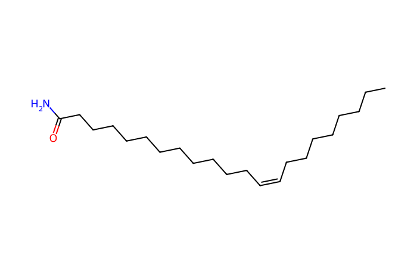

# MN Lab 7 · Can I Trust This Feature?

[← Lab 6](lab06-annotation-propagation.md) · [All labs](README.md) · [Lab 8 →](lab08-positive-vs-negative.md)

**About 45 min** · Data → features

Before you interpret a feature, ask whether it is measured reliably and comes from the sample at all. With 17 repeated injections of the same pooled QC sample and several blanks you will measure drift, reproducibility and contamination.

**What you will learn**

- what QC samples and blanks are for
- signal drift during a run
- the coefficient of variation (CV) as a measure of reproducibility
- blank filtering and typical contaminants
- PCA as a quick overview of a whole dataset

## Downloads

- [FeatureFinder-local-v365-windows-x86_64-MN-labs.zip](https://github.com/YasinEl/temp_share/releases/download/mn-teaching-materials-2026-10-29/FeatureFinder-local-v365-windows-x86_64-MN-labs.zip) · Feature Finder v365 with the ten MN Lab dashboards and the spectral library (Windows, 25 MB)
- [urine_POS.zip](https://github.com/YasinEl/temp_share/releases/download/urine-pos-test-data-2026-10-28/urine_POS.zip) · urine, positive mode: 11 mzML files + metadata.tsv (135 MB)
- [urine_QC_extra.zip](https://github.com/YasinEl/temp_share/releases/download/mn-teaching-materials-2026-10-29/urine_QC_extra.zip) · 27 more urine files: QC injections, blanks, MS1-only runs + metadata_QC_series.tsv (130 MB)
- Worksheet to write your answers in: [MN_Lab_7_Can_I_Trust_This_Feature_questions.docx](https://github.com/YasinEl/temp_share/releases/download/mn-teaching-materials-2026-10-29/MN_Lab_7_Can_I_Trust_This_Feature_questions.docx)
- Printable handout (same content as this page): [MN_Lab_7_Can_I_Trust_This_Feature_handout.docx](https://github.com/YasinEl/temp_share/releases/download/mn-teaching-materials-2026-10-29/MN_Lab_7_Can_I_Trust_This_Feature_handout.docx)

## Step by step

Start the app and open the lab as in [Getting started](getting-started.md), but with the files named in step 1 below.

1. Load the 38 files and drop **metadata_QC_series.tsv** on the **Sample metadata** box. Set **Engine** to **v1 (classic)** and **Quantification** to **Peak area**, run **Find Features** and open MN Lab 7 (under Plugins → Yours).
2. Panel 1 shows the run: the summed signal of every QC injection in injection order. → **Worksheet [Q1](#q1)**
3. Panel 2: the CV distribution of the QC injections, with sliders for the detection rate and the CV cut-off, and CV against intensity. → **[Q2](#q2)**
4. Tick **use only detected values** and watch the histogram and the CV plot. → **[Q3](#q3)**
5. Panel 3: the blank filter. Search the list for 338.342 and 144.982; then look up 114.066 and 152.071. → **[Q4](#q4)**
6. Panel 5: the PCA. Switch to **only features that pass**. → **[Q5](#q5)**
7. Panel 4: what is left after all filters, and how many molecular families lose every member. → **[Q6](#q6)**
8. Panel 6 lets you inspect single features (most/least reproducible, strongest drift) with their QC trend and XICs.

> **Watch out**
>
> - A low CV does not mean a feature is biologically interesting — and a high CV feature can still be real but close to the detection limit.
> - Contaminants usually have no library match and often unusual mass defects.

## Questions

Write your answers in the worksheet [MN_Lab_7_Can_I_Trust_This_Feature_questions.docx](https://github.com/YasinEl/temp_share/releases/download/mn-teaching-materials-2026-10-29/MN_Lab_7_Can_I_Trust_This_Feature_questions.docx).

#### Q1

Look at the drift plot. Does the summed signal change between the first and the last QC injection? By roughly how many percent? What would that do to a comparison between a patient measured early and one measured late?

#### Q2

What fraction of the features has a QC CV ≤ 30%? Now look at the CV-vs-intensity plot: which features are the least reproducible, large or small ones? Why?

#### Q3

Tick “use only detected values”. How does the picture change? What does gap-filling do for features that are close to the detection limit?

#### Q4

Search the blank list for m/z 338.342 and 144.982. Neither has a library name. What could they be, and where do they come from? (Hint: plastic tubes, the mobile phase.) Then look up creatinine (114.066) and paracetamol (152.071): both are found in the blanks too. Why do they still pass the blank filter?

#### Q5

In the PCA, where do the QC injections sit relative to the patients? What would it mean if the QCs were spread as widely as the patients? Switch to “only features that pass”: what changes?

#### Q6

How many molecular families lose all their members after filtering? Should you filter *before* or *after* networking? (There is no single right answer — argue it.)

## Background

### The QC series

Data: the 11 urine files **plus** urine_QC_extra (17 injections of the pooled urine spread over the run, 2 more blanks and MS1-only runs of the 8 patients); 38 files in total. Load **metadata_QC_series.tsv**. A pooled QC is the same sample every time: any difference between its injections is **technical**.

### Drift and CV

The instrument's response slowly changes during a long run (source contamination, column ageing): **drift**. The **CV** (standard deviation / mean × 100%) of a feature across the QC injections measures its reproducibility; ≤ 20–30% is usually acceptable in untargeted metabolomics.

### Blanks

A blank (solvent through the whole procedure) shows what does **not** come from the sample: plastics, solvents, mobile-phase additives, carry-over from the previous injection. A common rule: drop a feature if its mean in the blanks is more than 30% of its mean in the samples.

### PCA

Principal component analysis turns the whole feature table into one map: each sample is a point, similar samples lie close together. QCs should form a tight cluster; if they are as spread as the patients, technical noise dominates.

## Molecules in this lab

Erucamide comes from plastic tubes. Creatinine and paracetamol are real urine compounds that also appear in the blanks by carry-over.

| Structure | Molecule |
|---|---|
|  | **Erucamide** C22H43NO · [M+H]⁺ 338.3417 slip agent in plastic tubes: a contaminant *in this run: 338.342 @ 10.03 min (blanks!)* |
|  | **Creatinine** C4H7N3O · [M+H]⁺ 114.0662 body-made, from muscle creatine; cleared by the kidney *in this run: 114.066 @ ~9.5 min (everyone)* |
|  | **Paracetamol (acetaminophen)** C8H9NO2 · [M+H]⁺ 152.0706 painkiller; also carry-over into the blanks *in this run: 152.071 @ 7.15 min* |

---

[← Lab 6](lab06-annotation-propagation.md) · [All labs](README.md) · [Lab 8 →](lab08-positive-vs-negative.md)
