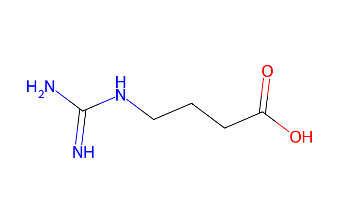
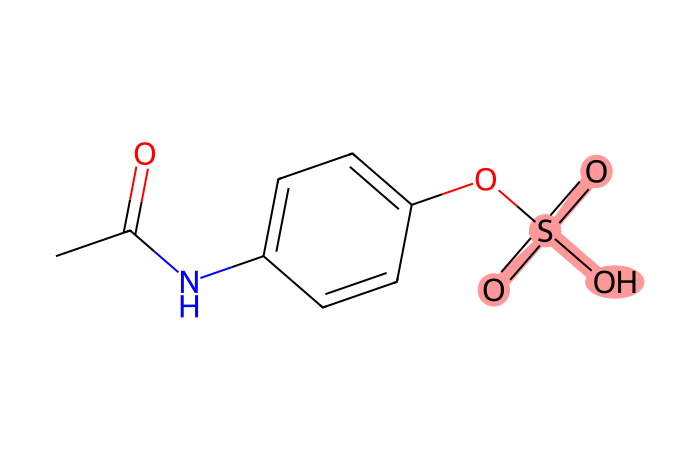
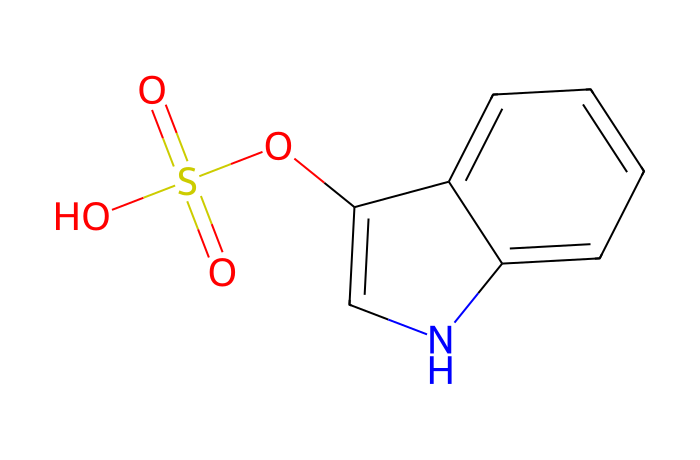
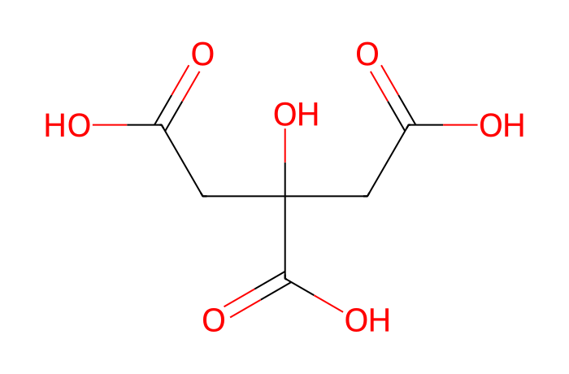
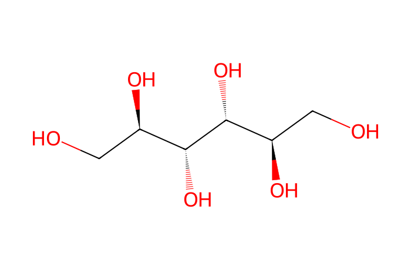

# MN Lab 8 · Positive vs Negative

[← Lab 7](lab07-can-i-trust-this-feature.md) · [All labs](README.md) · [Lab 9 →](lab09-modifinder.md)

**About 45 min** · Study design

Electrospray can make positive or negative ions. Each polarity sees a different part of the metabolome. You will compare the same urines measured in both modes.

**What you will learn**

- which molecules ionise in positive and which in negative mode
- how little two polarities overlap
- the positive-mode bias of spectral libraries
- how to spot impossible library hits from the mass defect
- sulfates as a negative-mode speciality

## Downloads

- [FeatureFinder-local-v365-windows-x86_64-MN-labs.zip](https://github.com/YasinEl/temp_share/releases/download/mn-teaching-materials-2026-10-29/FeatureFinder-local-v365-windows-x86_64-MN-labs.zip) · Feature Finder v365 with the ten MN Lab dashboards and the spectral library (Windows, 25 MB)
- [urine_NEG.zip](https://github.com/YasinEl/temp_share/releases/download/mn-teaching-materials-2026-10-29/urine_NEG.zip) · urine, negative mode: 11 mzML files + metadata.tsv (138 MB)
- [urine_POS_results.zip](https://github.com/YasinEl/temp_share/releases/download/mn-teaching-materials-2026-10-29/urine_POS_results.zip) · the app's results for urine_POS (aligned_features.csv + library_matches.tsv), + xic_positive.json (its LC peaks), to upload in panel 1
- Worksheet to write your answers in: [MN_Lab_8_Positive_vs_Negative_questions.docx](https://github.com/YasinEl/temp_share/releases/download/mn-teaching-materials-2026-10-29/MN_Lab_8_Positive_vs_Negative_questions.docx)
- Printable handout (same content as this page): [MN_Lab_8_Positive_vs_Negative_handout.docx](https://github.com/YasinEl/temp_share/releases/download/mn-teaching-materials-2026-10-29/MN_Lab_8_Positive_vs_Negative_handout.docx)

## Step by step

Start the app and open the lab as in [Getting started](getting-started.md), but with the files named in step 1 below.

1. Process the 11 files of **urine_NEG** in the app (negative mode) with their **metadata.tsv** and **Engine v1 (classic)**, and open MN Lab 8 there.
2. Panel 1: click the file button and select **all three files** of the positive run: **aligned_features.csv**, **library_matches.tsv** and **xic_positive.json** (unzip **urine_POS_results.zip** first, see Downloads). Then click **Compare**. The xic file holds the positive LC peaks: the app can only read the raw files of the run that is open.
3. Panel 2, **who sees what**: counts, the RT/mass map and the bars per minute (positive only / negative only / both). → **Worksheet [Q1](#q1), [Q2](#q2)**
4. Panel 3, library matches side by side: choose **named, and the molecule is seen in both polarities** and click a compound. Section 4 shows its areas in both modes. → **[Q3](#q3)**
5. Section 4, the **ion table**: every ion the feature finder grouped into this molecule, in each mode, with its adduct ([M+H]⁺, [M+Na]⁺, [M−H]⁻, …), isotope label, m/z and the neutral mass M worked out from the adduct. Below it the **LC peaks** in every sample: positive on the left, negative on the right. Click an ion to see its LC peak. Then pick a compound named **only in positive** (panel 3): the negative plot shows the trace at the m/z its [M−H]⁻ would have. → **[Q6](#q6)**
6. Choose **precursor m/z does not fit the library spectrum** and look at “citric acid” and “mannitol”. → **[Q4](#q4)**
7. Panel 5, the sulfate finder. → **[Q5](#q5)**

> **Watch out**
>
> - Never compare peak areas between polarities: compare samples within one polarity.
> - If a drug class is missing in positive mode (e.g. diuretics), look in negative mode.
> - Same molecule, same neutral mass M: the ions differ by the adduct, not by the molecule. [M+H]⁺ and [M−H]⁻ of one molecule are 2.0146 apart in m/z.

## Questions

Write your answers in the worksheet [MN_Lab_8_Positive_vs_Negative_questions.docx](https://github.com/YasinEl/temp_share/releases/download/mn-teaching-materials-2026-10-29/MN_Lab_8_Positive_vs_Negative_questions.docx).

#### Q1

How many features does each polarity find, and how many molecules are seen in both? Is the overlap larger or smaller than you expected?

#### Q2

In the RT/m/z map, where do the “negative only” features sit? HILIC retains polar compounds longer: which kinds of molecules elute late and ionise only negatively?

#### Q3

Choose “named, and the molecule is seen in both polarities” and pick a compound. Do its positive and negative areas rise and fall together across the patients? What does that tell you about using either polarity for quantification?

#### Q4

Choose “precursor m/z does not fit the library spectrum”. Look at “citric acid” at m/z 190.88 and “mannitol” at 180.93. What m/z should [M−H]⁻ of citric acid have? Look at the decimals (the mass defect): can an organic molecule of this size have a mass defect of −0.1? What else could it be? What should the library search have checked?

#### Q5

How many negative-mode spectra show the sulfate fragments (HSO₄⁻ 96.960, SO₃⁻ 79.957)? How many of those molecules were seen at all in positive mode? Which drugs and body-made compounds are excreted as sulfates?

#### Q6

Section 4: pick 4-guanidinobutanoate. Which ions of it does the ion table list in each mode, and do their neutral masses M agree? Compare the LC peaks in both modes: same retention time, same shape? Then pick a compound named only in positive mode: is there anything in the negative trace at its expected [M−H]⁻ m/z? Why would a molecule give a strong [M+H]⁺ but no [M−H]⁻?

## Background

### Ionisation

In **positive** mode molecules take up a proton ([M+H]⁺): bases such as amines, many drugs. In **negative** mode they lose one ([M−H]⁻): acids such as carboxylic acids, sulfates, phenols, glucuronides. Many molecules ionise mainly in one mode. The [M+H]⁺ and [M−H]⁻ of one molecule differ by 2 × 1.00728 = 2.01455.

### Mass defect

The **mass defect** is the part of the mass after the decimal point relative to the nominal mass. Organic molecules (C, H, N, O) have small positive defects that grow with size (H = 1.0078). Heavy inorganic atoms (Na, K, Cl, metals) have negative defects. An ion at m/z 190.88 (defect −0.12) cannot be an organic acid: it is a salt cluster.

### Sulfates

Sulfate conjugates (drug metabolites, phenolic compounds from food, steroid sulfates, uraemic toxins such as indoxyl sulfate) give characteristic fragments in negative mode: **HSO₄⁻ (96.960)** and **SO₃⁻• (79.957)**.

## Molecules in this lab

For citric acid and mannitol compare the true [M−H]⁻ (given below each structure) with the library “hits” at m/z 190.88 and 180.93.

| Structure | Molecule |
|---|---|
|  | **4-Guanidinobutanoic acid** C5H11N3O2 · [M+H]⁺ 146.0924 body-made; seen in both polarities *in this run: 146.092 [M+H]⁺ / 144.078 [M−H]⁻ @ 13.4 min* |
|  | **Paracetamol sulfate** C8H9NO5S · [M+H]⁺ 232.0274 phase II metabolite (+79.957) *in this run: 232.027 (POS) / 230.013 [M−H]⁻ (NEG)* |
|  | **Indoxyl sulfate** C8H7NO4S · [M−H]⁻ 212.0023 gut-microbial uraemic toxin; a typical sulfate *in this run: 212.002 [M−H]⁻ @ 7.14 min (every patient)* |
|  | **Citric acid** C6H8O7 · [M−H]⁻ 191.0197 true [M−H]⁻ 191.020 — not the 190.88 “hit” |
|  | **Mannitol** C6H14O6 · [M−H]⁻ 181.0718 true [M−H]⁻ 181.072 — not the 180.93 “hit” |

---

[← Lab 7](lab07-can-i-trust-this-feature.md) · [All labs](README.md) · [Lab 9 →](lab09-modifinder.md)
