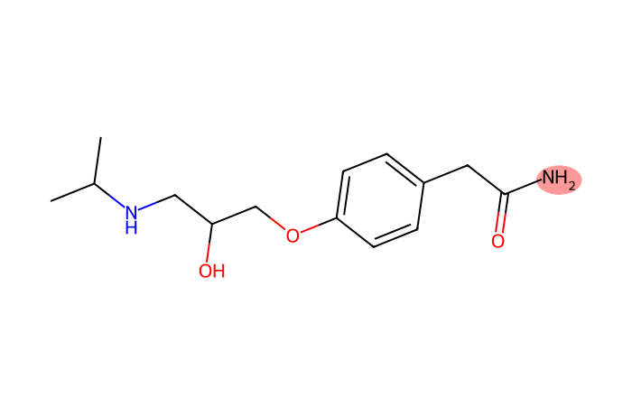
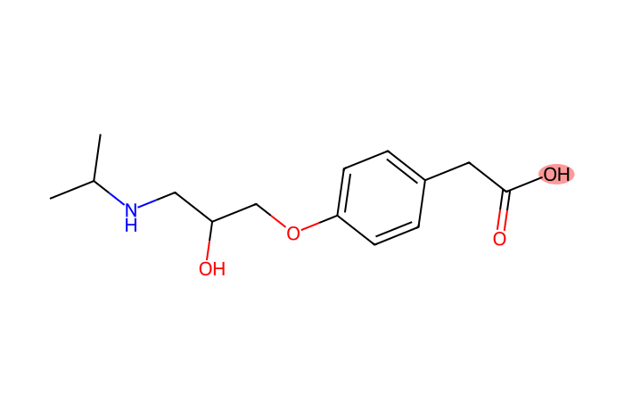
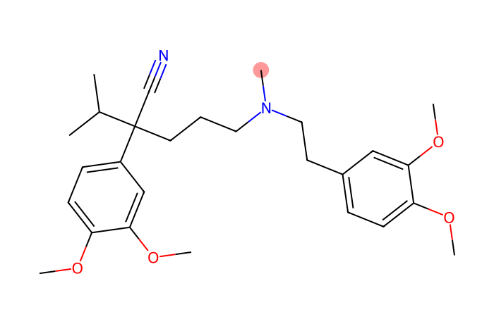
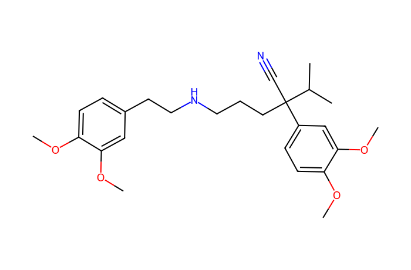
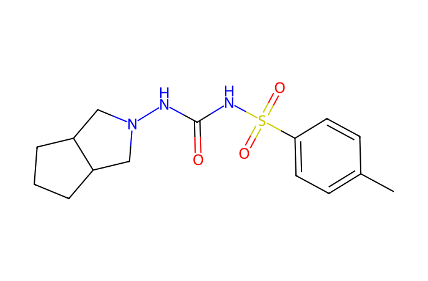
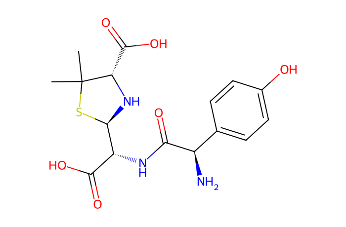

# MN Lab 9 · ModiFinder

[← Lab 8](lab08-positive-vs-negative.md) · [All labs](README.md) · [Lab 10 →](lab10-pool-ms-ms-vs-every-sample.md)

**About 50 min** · Interpreting it

The network tells you that an unknown is a modified version of a known compound, but not **where** the modification is. ModiFinder uses the fragments to point to the most likely site on the structure.

**What you will learn**

- the idea behind ModiFinder: shifted fragments contain the modification, unshifted ones do not
- how fragments are assigned to substructures of the known molecule
- how to read the likelihood map on the structure
- when ModiFinder works and when it cannot work

## Downloads

- [FeatureFinder-local-v365-windows-x86_64-MN-labs.zip](https://github.com/YasinEl/temp_share/releases/download/mn-teaching-materials-2026-10-29/FeatureFinder-local-v365-windows-x86_64-MN-labs.zip) · Feature Finder v365 with the ten MN Labs, the GNPS libraries and all handouts (Windows, 87 MB)
- [urine_POS.zip](https://github.com/YasinEl/temp_share/releases/download/urine-pos-test-data-2026-10-28/urine_POS.zip) · urine, positive mode: 11 mzML files + metadata.tsv (135 MB)
- Worksheet to write your answers in: [MN_Lab_9_ModiFinder_questions.docx](https://github.com/YasinEl/temp_share/releases/download/mn-teaching-materials-2026-10-29/MN_Lab_9_ModiFinder_questions.docx)
- Printable handout (same content as this page): [MN_Lab_9_ModiFinder_handout.docx](https://github.com/YasinEl/temp_share/releases/download/mn-teaching-materials-2026-10-29/MN_Lab_9_ModiFinder_handout.docx)

## Step by step

**Before you start:** do [Getting started](getting-started.md) with the 11 files of urine_POS (Engine **v1 (classic)**), then open **MN Lab 9 · ModiFinder** from the **All plugins** tab.

1. Open MN Lab 9. The **Examples** card lists curated drug → metabolite pairs of this run; below it, every network edge from a library match to a neighbour. Click **Ramipril → Ramiprilat**.
2. The **Input** card is filled in: the feature (row ID) and SMILES of the known compound, the modified compound's feature and (optionally) its SMILES. Settings: ppm tolerance 40, base peak filter 0.01, adduct [M+H]1+. **update** runs ModiFinder.
3. Read the statistics (matched and shifted peaks), the **Prediction** and the **Modification Highlight**. → **Worksheet [Q1](#q1)**
4. Run **Atenolol → Atenolol acid**. → **[Q2](#q2)**
5. Run **Verapamil → Norverapamil**, then replace the modified feature by the other feature with m/z 441.274 (see the network pairs table) and press update. → **[Q3](#q3)**
6. Run **Amitriptyline → Hydroxy-amitriptyline** and look at the Peaks plot. → **[Q4](#q4)**
7. In any pair, click a red peak of the known compound: **Peak info** shows its candidate substructures. Untick unlikely ones and press **apply selection and recompute**. → **[Q5](#q5)**
8. Run **Amoxicillin → Amoxicilloic acid**. → **[Q6](#q6)**
9. In **Pairs in this run's molecular network**, filter for 176.03 and run a glucuronide pair. → **[Q7](#q7)**
10. Take one of the drug analogues from the main task (e.g. hydroxy-gliclazide or hydroxy-irbesartan) and propose a structure. → **[Q8](#q8)**

> **Watch out**
>
> - The prediction is a probability map, not an answer: check it against chemistry (which positions are typically hydroxylated or glucuronidated?).
> - More shifted peaks = more reliable prediction. With 0–1 shifted peaks, be very careful.

## Questions

Write your answers in the worksheet [MN_Lab_9_ModiFinder_questions.docx](https://github.com/YasinEl/temp_share/releases/download/mn-teaching-materials-2026-10-29/MN_Lab_9_ModiFinder_questions.docx).

> **What ModiFinder does.** It takes a compound whose structure you know (a library match) and an analogue that is connected to it in the network. Fragments of the known compound that appear *shifted* by the precursor Δ in the analogue's spectrum carry the modification; fragments that appear at the *same* m/z do not. Adding this up over all substructures that can explain each fragment gives a likelihood for every atom.

#### Q1

Open the example *Ramipril → Ramiprilat*. Which atoms does the Prediction highlight? Compare with the Modification Highlight: how much of the likelihood falls on the atoms that are really removed? How many shifted peaks is the prediction based on?

#### Q2

Open *Atenolol → Atenolol acid* (Δ +0.984). Where does ModiFinder put the change? The library calls both features “Atenolol” — what does the precursor m/z tell you, and why would a library match alone have misled you?

#### Q3

Open *Verapamil → Norverapamil*. Two features in this run have m/z 441.274 at different retention times. Run ModiFinder on both (change the Feature of the modified compound). Do they give the same prediction? Which one is N-demethylated and which O-demethylated?

#### Q4

Open *Amitriptyline → Hydroxy-amitriptyline*. How many shifted peaks are there? What does ModiFinder do when no fragment shifts, and why can it then not localise the +O?

#### Q5

Click a *shifted* (red) peak of the known compound in the Peaks plot. How many substructures fit it? Untick the ones you find chemically unlikely and press “apply selection and recompute”. How does the prediction change? What is the main limitation of the method?

#### Q6

Open *Amoxicillin → Amoxicilloic acid* (+H₂O). Why is there no Modification Highlight? Which assumption of ModiFinder does this pair break?

#### Q7

In “Pairs in this run's molecular network”, filter for 176.03 (glucuronides). Pick one: where does ModiFinder put the glucuronic acid? Is that chemically plausible (which groups can be glucuronidated)?

#### Q8

Pick one of the drug analogues you found for the main task (e.g. hydroxy-irbesartan or hydroxy-gliclazide). Use ModiFinder to propose where the modification is, and write down a candidate structure. How confident are you, and what would you need to confirm it?

## Background

### The idea

ModiFinder (Shahneh et al., J. Am. Soc. Mass Spectrom. 2024) needs a **known compound** (structure + MS/MS) and a **modified compound** (its MS/MS). It aligns the two spectra like the modified cosine (MN Lab 1). Every fragment of the known compound is explained by the substructures that fit its m/z (a computer breaks up to 2 bonds of the molecule and lists all pieces). Atoms in substructures of **shifted** fragments gain likelihood; atoms in substructures of **unshifted** fragments lose it. Ambiguous fragments (many possible substructures) count less.

### Reading the result

The **Prediction** colours every atom from blue (unlikely) to red (likely site). If you also give the structure of the modified compound (SMILES2), the **Modification Highlight** shows the true site, so you can check the prediction. The **Peaks** plot shows the aligned spectra: red = shifted, blue = unshifted. Click a peak of the known compound to see its candidate substructures; untick wrong ones and recompute.

### Limits

ModiFinder needs shifted fragments: if the modified part is lost in every fragment, it cannot localise it. It assumes the analogue is the known compound plus or minus one group; ring openings or rearrangements break this. Isomeric sites that give the same fragments cannot be told apart.

## Molecules in this lab

Red: the atoms that change (ethyl ester in ramipril, amide N → O in atenolol, N-methyl in verapamil). For hydroxy-gliclazide, hydroxy-irbesartan and hydroxy-amitriptyline the position of the +O is unknown — that is what you ask ModiFinder.

| Structure | Molecule |
|---|---|
|  | **Ramipril** C23H32N2O5 · [M+H]⁺ 417.2384 ACE inhibitor; prodrug, ethyl ester *in this run: 417.238 @ 3.77 min (patient 08)* |
|  | **Ramiprilat** C21H28N2O5 · [M+H]⁺ 389.2071 active drug (−C₂H₄) *in this run: 389.207 @ 4.41 and 7.06 min* |
|  | **Atenolol** C14H22N2O3 · [M+H]⁺ 267.1703 beta-blocker (blood pressure) *in this run: 267.170 @ 13.34 min (patients 03, 57)* |
|  | **Atenolol acid** C14H21NO4 · [M+H]⁺ 268.1543 metabolite: amide → carboxylic acid (+0.984) *in this run: 268.154 @ 10.96 min* |
|  | **Verapamil** C27H38N2O4 · [M+H]⁺ 455.2904 calcium-channel blocker (patient 08) *in this run: 455.290 @ 4.15 min* |
|  | **Norverapamil** C26H36N2O4 · [M+H]⁺ 441.2748 N-demethylated metabolite (−CH₂) *in this run: 441.274 @ 4.94 or 7.08 min* |
|  | **Gliclazide** C15H21N3O3S · [M+H]⁺ 324.1376 sulfonylurea, diabetes (patient 105) *in this run: 324.138 @ 3.88 min* |
|  | **Irbesartan** C25H28N6O · [M+H]⁺ 429.2397 angiotensin receptor blocker (patient 54) *in this run: 429.240 @ 3.59 min* |
|  | **Amitriptyline** C20H23N · [M+H]⁺ 278.1903 tricyclic antidepressant / pain (patient 02) *in this run: 278.190 @ 7.09 min* |
|  | **Amoxicillin** C16H19N3O5S · [M+H]⁺ 366.1118 β-lactam antibiotic (patient 03) *in this run: 366.112 @ 4.64 min* |
|  | **Amoxicilloic acid** C16H21N3O6S · [M+H]⁺ 384.1224 β-lactam ring opened by water (+H₂O) *in this run: 384.122 @ 11.60 min* |

---

[← Lab 8](lab08-positive-vs-negative.md) · [All labs](README.md) · [Lab 10 →](lab10-pool-ms-ms-vs-every-sample.md)
