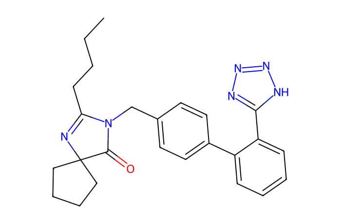
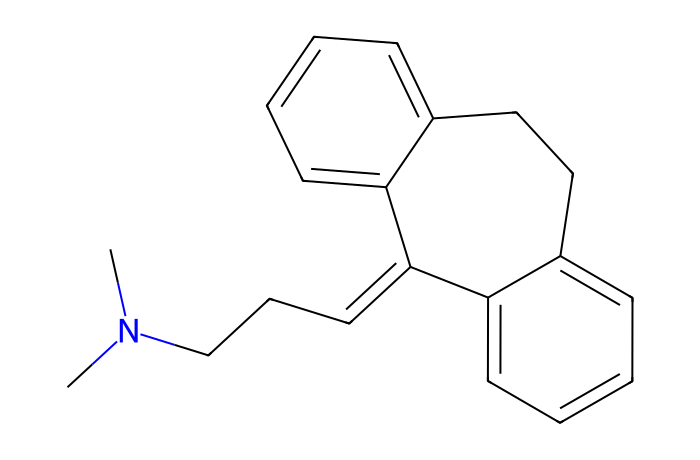
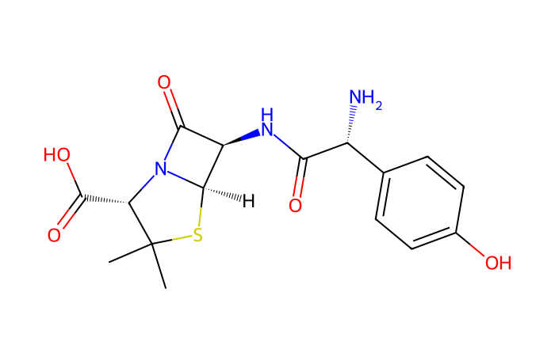
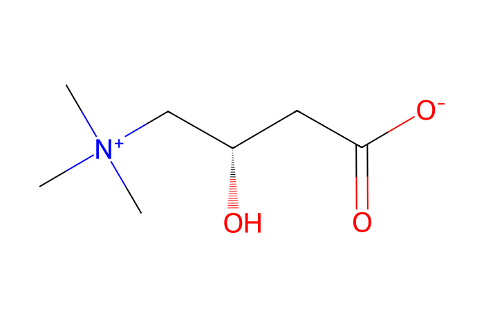

# MN Lab 10 · Pool MS/MS vs every sample

[← Lab 9](lab09-modifinder.md) · [All labs](README.md)

**About 60 min** · Study design

Many labs save instrument time by recording MS/MS only in a pooled QC and measuring every sample in MS1 only. You will check what this costs in a cohort of people who all take different drugs: which compounds lose their MS/MS spectrum and why, and whether MS/MS in every sample costs MS1 data.

**What you will learn**

- how data-dependent acquisition (DDA) picks ions for MS/MS
- why a pool dilutes what is special about one person
- how to tell dilution from crowding: too weak to trigger, or outcompeted by stronger ions
- what MS/MS in every sample costs the MS1 data (scan rate, points per peak, peak areas)
- when a pool-only design is acceptable and when it is not

## Downloads

- [FeatureFinder-local-v365-windows-x86_64-MN-labs.zip](https://github.com/YasinEl/temp_share/releases/download/mn-teaching-materials-2026-10-29/FeatureFinder-local-v365-windows-x86_64-MN-labs.zip) · Feature Finder v365 with the ten MN Labs, the GNPS libraries and all handouts (Windows, 27 MB)
- [urine_POS.zip](https://github.com/YasinEl/temp_share/releases/download/urine-pos-test-data-2026-10-28/urine_POS.zip) · urine, positive mode: 11 mzML files + metadata.tsv (135 MB)
- [urine_POS_pool_MSMS.zip](https://github.com/YasinEl/temp_share/releases/download/mn-teaching-materials-2026-10-29/urine_POS_pool_MSMS.zip) · optional: the run with MS/MS only from the pool (71 MB); its results are already in the app zip
- Worksheet to write your answers in: [MN_Lab_10_Pool_MS_MS_vs_every_sample_questions.docx](https://github.com/YasinEl/temp_share/releases/download/mn-teaching-materials-2026-10-29/MN_Lab_10_Pool_MS_MS_vs_every_sample_questions.docx)
- Printable handout (same content as this page): [MN_Lab_10_Pool_MS_MS_vs_every_sample_handout.docx](https://github.com/YasinEl/temp_share/releases/download/mn-teaching-materials-2026-10-29/MN_Lab_10_Pool_MS_MS_vs_every_sample_handout.docx)

## Step by step

**Before you start:** do [Getting started](getting-started.md) with the 11 files of urine_POS (Engine **v1 (classic)**), then open **MN Lab 10 · Pool MS/MS vs every sample** from the **All plugins** tab.

1. Open MN Lab 10 in the urine_POS run and press **Read the MS/MS scans**. The lab reads the list of MS/MS scans of every raw file. For each feature it checks whether the pool run fragmented it (pool only) or whether any run did (every sample). → **Worksheet [Q1](#q1)**
2. Left plot: the share of features with MS/MS, by how many patients have the feature. → **[Q2](#q2)**
3. Right plot: one run against one run. Hover over the bars of a patient. → **[Q3](#q3)**
4. Section 3, **named compounds that only a patient run fragmented**. Type a name into the filter and click a row. Section 4 shows the LC peak in every sample (pool dashed) and every MS/MS scan taken at that m/z (pool in orange). → **[Q4](#q4)**
5. Section 3, **features only the pool fragmented** and **features in a patient that no run fragmented**. → **[Q5](#q5)**
6. Section 5: load **aligned_features.csv** and **library_matches.tsv** from MN_teaching\handout\urine_POS_poolMSMS_results. This is the app's result for the real pool-only design: the 8 *_fullscan* files + the pool + 2 blanks, dataset urine_POS_pool_MSMS. Optional: process that dataset yourself. → **[Q6](#q6)**
7. Section 6: press **Explain the misses** for **named compounds the pool missed**. Click amitriptyline and irbesartan in the table. Section 4 then shows the DDA cycles around the ion in the pool (top) and in the patient (bottom). Grey bars are the MS/MS slots used, red when all 10 were used. Black dashes mark the weakest ion picked in that cycle and the purple line the trigger floor. Green stars are MS/MS scans of this ion. → **[Q7](#q7)**
8. Section 6 again with **features in 1–2 patients the pool missed**; read the scatter (pool vs patient intensity, with the 10× dilution line). → **[Q8](#q8)**
9. Section 7, top: MS1 scan rate and MS1 points per peak, DDA patient runs against the MS1-only blanks. → **[Q9](#q9)**
10. Section 7, bottom (after section 5): peak areas of each patient's DDA run vs its MS1-only run, plus the pooled urine as a same-file reference. Switch patients; red points are peaks with fewer than 5 MS1 points per FWHM in the DDA run. → **[Q10](#q10)**

> **Watch out**
>
> - A scan being taken is not the same as a good spectrum or a library match: section 5 shows what the app really named.
> - Change the m/z tolerance and RT window: the numbers move, the pattern does not.
> - The pool also contains 14 people who are not among these 8 patients: some features exist only in the pool.
> - The DDA and MS1-only runs of a patient are two separate injections. Compare their differences with the pool row (the same file in both runs) before blaming DDA.
> - “Crowded out” and “too weak” are not independent: dilution pushes an ion down the ranking, and a crowded region then has no slot left for it.

## Questions

Write your answers in the worksheet [MN_Lab_10_Pool_MS_MS_vs_every_sample_questions.docx](https://github.com/YasinEl/temp_share/releases/download/mn-teaching-materials-2026-10-29/MN_Lab_10_Pool_MS_MS_vs_every_sample_questions.docx).

> **The big question.** People differ: drugs, diet, gut microbes, disease. Is a pool of everyone a good stand-in for each person? When the pool misses a compound, is it because the compound is diluted, or because stronger ions took all the MS/MS slots? And what does MS/MS in every sample cost the MS1 data?

#### Q1

Press *Read the MS/MS scans*. How many features are found in at least one patient? What share of them gets an MS/MS spectrum with the pool-only design, and with MS/MS in every sample?

#### Q2

Left plot: how does the pool-only share change between features that all 8 patients have and features that only one patient has? The pool is a mix of 22 urines, and data-dependent acquisition (DDA) fragments only the most intense ions of each scan cycle. Explain the pattern.

#### Q3

Right plot: one run against one run. Hover over a patient: for *all* its features, does its own run get MS/MS for more of them than the pool run? And for the features *only this patient* has? Is the difference between the two designs just “more injections”?

#### Q4

Section 3, *named compounds that only a patient run fragmented*. Find irbesartan, amitriptyline, amoxicillin and daidzein. Which patients have them, and how much of each is left in the pool? Click irbesartan: what do the LC peaks and the MS/MS ticks show?

#### Q5

Choose *features only the pool fragmented*, then *features in a patient that no run fragmented*. How many are there? Give two reasons why the pool can win for some features. What does the last number say about DDA in general?

#### Q6

Section 5: load the real pool-only run (MN_teaching\handout\urine_POS_poolMSMS_results). How many features have MS/MS in each run, and how many compounds are named? Which names need MS/MS in every sample, and in how many patients are they? And the names found only in the pool-only run?

#### Q7

Section 6: press *Explain the misses* for *named compounds the pool missed*. How many fall into each class? Click amitriptyline and then irbesartan, and read section 4 (cycle plot and text). Why did the pool miss each one? Compare the ion's rank in the pool's MS1 scan with its rank in the patient's scan that triggered its MS/MS.

#### Q8

Switch to *features in 1–2 patients the pool missed* and explain again. Which class is the largest now, and how much of the patient's signal is left in the pool? So, is the signal missing from the pool because of dilution, or was the region too crowded for it to trigger? Is crowding independent of dilution?

#### Q9

Section 7, top: how many MS1 scans does a DDA patient run have, and an MS1-only run (the blanks)? How does the time between two MS1 scans change with the number of MS/MS taken in between? How many MS1 points cover a peak's FWHM in each design? Why can a DDA run have *more* MS1 scans in total and still fewer points across most peaks?

#### Q10

Section 7, bottom (needs the pool-only run of section 5): compare each patient's DDA run with its MS1-only run. How well do the peak areas agree (Spearman r, IQR of log₂ ratio), and how many features are found in only one of them? What does the pooled-urine row (the same file in both runs) tell you? Do peaks with fewer than 5 MS1 points differ more? Are signals or abundance differences lost because of DDA?

## Background

### Data-dependent acquisition

In DDA the instrument records a survey (MS1) scan and then fragments the **top N most intense ions** in it, one MS/MS scan each, before the next survey scan. Ions it has just fragmented are put on an exclusion list for some seconds (dynamic exclusion). Weak ions, or ions that co-elute with stronger ones, are often never fragmented.

### Two designs

|  | Pool only | Every sample |
|---|---|---|
| patients measured | MS1 only (full scan) | MS1 + DDA MS/MS |
| MS/MS comes from | the pooled QC (all urines mixed) | every run, pool included |
| advantage | less instrument time; the MS1-only runs keep a steady MS1 scan rate | a spectrum for what each person has |
| risk | compounds of one person are diluted in the pool | MS1 scans come less often when many MS/MS are taken |

This dataset has both on the **same urines**: each patient was measured once with DDA (*_T10_POS*) and once in full scan only (*_fullscan*). The pool (*Pooled_Urine_StrokeDrugs_24_POS*) is a mix of 22 urines.

### Why people differ

Every patient takes other drugs, eats other food and has other gut bacteria. A drug taken by one of 22 people is diluted about **20-fold** in the pool, often below what DDA will pick.

### Why the pool misses an ion: dilution or crowding?

An ion that is never fragmented in the pool falls into one of four cases. **Not in the pool:** diluted below detection. **Too weak:** visible, but below the intensity at which the instrument triggers MS/MS. The lab estimates this *trigger floor* as the 1st percentile of the precursor intensities the pool run picked. **Crowded out:** strong enough, but in every cycle around its peak all 10 MS/MS slots went to more intense ions. **Slots free, still not picked:** the scan list gives no reason (exclusion rules, isotope peaks, timing).

In the patient's own run the same ion is stronger and sits higher in the intensity ranking. Once the stronger ions have been fragmented and put on the exclusion list, it gets its turn.

### What DDA costs the MS1 data

Every MS/MS scan takes time between two MS1 scans, so the MS1 scans come less often when many ions are fragmented. Fewer MS1 points across a chromatographic peak can make its area less precise and weak peaks harder to find. A peak needs roughly 5–10 points across its full width at half maximum (FWHM) to be integrated well.

**Note:** in these files about 70% of the MS/MS scans store the precursor m/z rounded to 0.01 (up to 0.005 Da off). The lab allows 0.005 Da extra for those scans; without that, MS/MS coverage is badly underestimated.

## Molecules in this lab

Irbesartan (one patient) is too weak in the pool to trigger, and amitriptyline (two patients) is crowded out there. Amoxicillin (one patient) is not in the pool at all. Ramipril (one patient) was lucky: the pool fragmented it once. Carnitine is in everyone: the pool is enough.

| Structure | Molecule |
|---|---|
|  | **Irbesartan** C25H28N6O · [M+H]⁺ 429.2397 angiotensin receptor blocker (patient 54) *in this run: 429.240 @ 3.59 min* |
|  | **Amitriptyline** C20H23N · [M+H]⁺ 278.1903 tricyclic antidepressant / pain (patient 02) *in this run: 278.190 @ 7.09 min* |
|  | **Amoxicillin** C16H19N3O5S · [M+H]⁺ 366.1118 β-lactam antibiotic (patient 03) *in this run: 366.112 @ 4.64 min* |
|  | **Ramipril** C23H32N2O5 · [M+H]⁺ 417.2384 ACE inhibitor; prodrug, ethyl ester *in this run: 417.238 @ 3.77 min (patient 08)* |
|  | **L-Carnitine** C7H15NO3 · [M+H]⁺ 162.1125 body-made: carries fatty acids into mitochondria *in this run: 162.113 @ 12.16 min (everyone)* |

---

[← Lab 9](lab09-modifinder.md) · [All labs](README.md)
